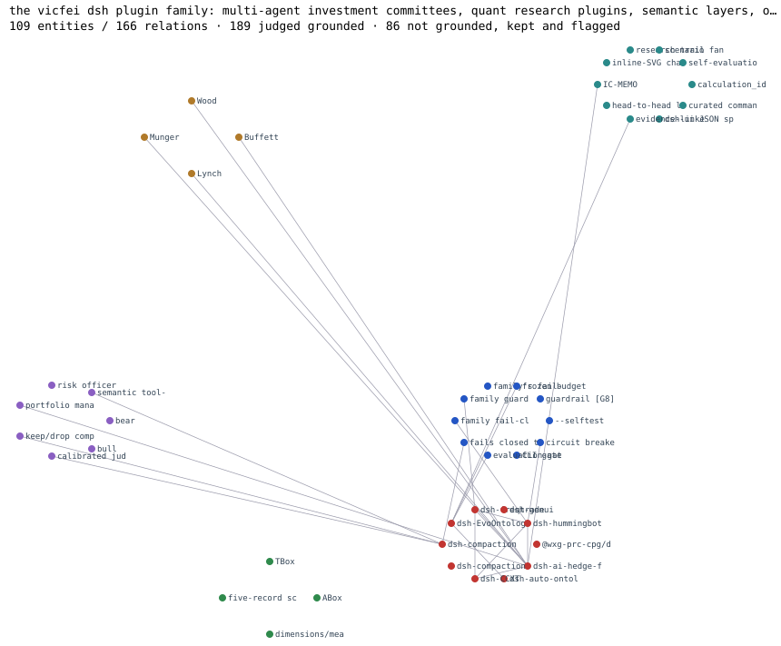

# dsh-auto-ontology — auto ontology construction with evidence, for DeepSeek Harness

**Feed it documents; get a typed ontology (TBox + ABox) where every entity and
relation carries its source quote. No evidence, no assertion; unknown types are
flagged, never silently dropped.**

[](https://github.com/deepseek-ai) [](LICENSE) [](https://www.npmjs.com/package/dsh-auto-ontology) [](../../actions/workflows/ci.yml) [](docs/FORMAT.md)

> Implements the concept of [NVIDIA/auto-ontology](https://github.com/NVIDIA/auto-ontology)
> (13.3k★) natively for DSH, with the family's evidence discipline. Clean-room,
> zero upstream code. Not affiliated. [中文文档](README.zh-CN.md)
> Family: [dsh-TradingAgents](https://github.com/vicfei/dsh-TradingAgents) · [dsh-WrenAI](https://github.com/vicfei/dsh-WrenAI)



*A real run over the 19 public READMEs of the vicfei dsh family
(2026-11-25): 109 entities / 166 relations, every assertion carrying its
evidence quote. The build judged 189 of them grounded ✓ and kept 86 flagged ⚠
— `ontologies/20261125-1718.*`. An earlier run with 4 organically detected
type conflicts is kept as `ontologies/20261118-1441.*`.*

## Why (ontology plugins exist — none does LLM auto-construction with evidence)

| | NVIDIA auto-ontology (upstream) | ontology viewers/bridges | **dsh-auto-ontology** |
|---|---|---|---|
| Corpus | enterprise DB metadata (8 connectors) | — | **documents** — any text you already have |
| Builds ontologies | governed semantic layer (Docker/Postgres stack) | no (view existing) | **two-pass LLM: TBox schema from a sample, then per-doc ABox assertions** |
| Trust | grounding at answer time | — | **evidence spans at build time — no evidence, no assertion** |
| Conflicts | reconcile definitions | — | **both evidences kept, never silently resolved** |
| Incremental | metadata ingest | — | **append-only fold; certifications respected forever** |
| Infra | Docker + Postgres + API key stack | — | **zero-infra stdlib CLI + any DeepSeek-compatible key** |

## Quick start (zero extra keys)

```bash
npm i -g dsh-auto-ontology
auto-ontology build --docs 'docs/*.md' --domain "internal design docs" --save
auto-ontology build --kb <knowledge-base-id> --domain "..." --save   # from a WeKnora knowledge base: every quote names its chunk
auto-ontology --query "WrenAI"                 # every assertion + its evidence spans
auto-ontology validate ontologies/*.json       # format v0.3 conformance
auto-ontology eval --from ontologies/x.json --n 20   # honest evidence-support precision
auto-ontology export ontologies/x.json > trajectory.ndjson   # the artifact as events
auto-ontology apply --proposals run.proposals.json --actor agent:<name>   # a judge's re-typing, applied as a certification
```

Requires `python3` (stdlib only) + a `DEEPSEEK_API_KEY`. Artifacts land in
`./ontologies/`: typed JSON (every assertion + evidence), zero-dep SVG cluster
graph, markdown digest, single-file HTML report, JSON-LD export.

The grounding pass is the expensive part: one judge call per assertion plus
one re-ground call per document (the 19-README showcase took 514 calls, 184 s,
360k tokens). `--no-ground` skips it; `--max-calls N` stops a run before it
overshoots.

Register the DSH skill: `ln -s "$(npm root -g)/dsh-auto-ontology/skills/dsh-auto-ontology" ~/.dsh/skills/dsh-auto-ontology`.
With the plugin installed, agents get `ontology_build` / `ontology_query` /
`ontology_export` as typed tools (`dsh plugin add dsh-auto-ontology`).

### From a WeKnora knowledge base — evidence that names its chunk

```bash
export WEKNORA_URL=http://127.0.0.1:8080
export WEKNORA_API_KEY=<key>          # and WEKNORA_TENANT_ID when your key needs one
auto-ontology build --kb <knowledge-base-id> --domain "..." --save [--limit N]
```

The base's parsed chunks are the corpus — one chunk is one document, read
whole, in a fixed reading order — and **every evidence carries the `chunk_id`
it was read from**, so each assertion resolves back to a place in the base
(`GET /api/v1/chunks/by-id/{id}`). Only documents whose parse completed are
read; `--query` prints the chunk beside every quote; `provenance.kb` records
what was read and what was skipped. The build only reads the base. The typed
tool takes `kb` + `limit` (40 chunks unless told otherwise). Same family stack
as [dsh-WrenAI](https://github.com/vicfei/dsh-WrenAI), with no overlap: WrenAI
answers *from* a model over your data, we audit *what the knowledge base
claims*. Details: FORMAT.md, *Building from a knowledge base*.

## The discipline (non-negotiables)

- **Evidence is inseparable** from an assertion — a verbatim quote + source doc;
- **Type guard**: instance types must come from the extracted TBox; unknown
  types are flagged, never silently dropped;
- **Grounding is judged, flagged, never dropped**: after extraction, every
  type and relation claim is checked against its own quote. The only
  mechanical reject is the verbatim check — a span not in the document is not
  evidence. Every verbatim quote then gets one strict judge call (temperature
  0, `--judge-model` to pick another model, `--max-calls` respected); the
  judge sees the quote, not the document. A quote that fails gets one
  re-grounding attempt and a re-judge of the repaired quote; if it still
  fails, the assertion stays in the ABox with `type_grounding: false` /
  `grounding: false` — queryable, certifiable, never silently lost. `--query`
  marks each ✓ or ⚠;
- **Append-only**: merges never edit or drop prior evidence; removals happen
  only via `--certify reject` and are recorded with the original evidence and
  the actor who issued the verdict (`--actor`);
- **Conflicts keep both sides** — the same name under different types becomes a
  conflict entry holding BOTH evidences, awaiting review;
- **Honest metrics**: `auto-ontology eval` measures whether quotes actually
  support their assertions (seeded, rerunnable; `--n 0` scores the whole
  population, `--adversarial` runs 28 trap-and-true cases through the same
  judge). Our first artifacts scored **10%** — reported as-is. The build-time
  grounding pass answers it. On the same frozen 19-README corpus
  (2026-11-25) strict-judge precision went **25% → 67%** under deepseek-chat
  and **9% → 50%** under deepseek-reasoner; among assertions the pass
  flags ✓, 96% and 71% hold up. Every table, every judged row and the
  blind audit are in [eval/](eval/README.md). A ✓ is one verdict at build
  time — a re-judge moves a few percent. A metric you can rerun beats a
  number you can't;
- Every artifact carries **provenance** (model / judge model / temperature /
  calls / tokens / elapsed).

## Format: evidence-linked ontology v0.3

The artifact shape is a versioned open format — [docs/FORMAT.md](docs/FORMAT.md) —
with a stdlib conformance validator, enforced by CI on the committed showcase.
v0.2 adds optional grounding fields (`grounded` / `reason` on an evidence,
`type_grounding` on an entity, `grounding` on a relation, `actor` on a
certification); v0.3 adds `chunk_id` on an evidence (a knowledge-base build)
and `judge` on a quote an outside judge grounded (`apply --proposals`), plus
`provenance.kb`. Every earlier artifact still conforms. If other tools adopt
it, assertions stay auditable across implementations.

The artifact is a state; `auto-ontology export` is what happened — an
`ao-trajectory/0.1` stream (newline JSON) with one event per evidence quote
and the judge's verdict on it, plus every certification (who issued it, the
note), merges, conflicts and the type guard's catches. It is deterministic and
idempotent by event id: replaying it adds nothing. It is the contract
dsh-EvoOntology's adapter
([evoontology #9](https://github.com/vicfei/dsh-EvoOntology/issues/9)) is
written against — see FORMAT.md, *Trajectory stream*.

The stream is also how a proposal comes back. dsh-EvoOntology's adapter
imports it, projects the layer (one Term per typing, every quote with its
verdict), asks a model for a better typing of each ungrounded Term, has a
judge check each proposal against one of the Term's own quotes, and publishes
a new layer only when its gate improves.
`auto-ontology apply --proposals <run>.proposals.json --actor agent:<name>`
then applies every judge-grounded proposal as a **certification** — a reject
on the old typing, with `retyped_to` naming the new type and the quote — plus
a new assertion whose first evidence is that quote, carrying the judge's name
and its reason. Nothing is edited: a
person's verdict on the name stops it, a stale proposal is reported, a replay
writes nothing. See FORMAT.md, *The trip back*.

## Status & roadmap

O1–O4 complete (see [ROADMAP](ROADMAP.md)): English-first engine, npm
distribution vehicle + typed tools, incremental merge & coreference & conflicts,
JSON-LD / HTML / WeKnora bridge, certification fold-back, run-layer diff, the
honest eval, format v0.2. O5.0 landed 2026-11-25: the grounding pass and its
before/after (#35). O5.1 and O5.2 landed the same day, format v0.3: the
trajectory stream that dsh-EvoOntology reads and the trip back that applies
its judge's re-typing, closed in [one live round across the two
repositories](eval/live-round/README.md); and `build --kb`, with every chunk id
of [a real knowledge base round](eval/kb-round/README.md) verified. The
release train for 0.3.0 is O5.4.

## License

MIT; concept credit to Apache-2.0 upstream — zero upstream code used.
**Not enterprise advice.**
