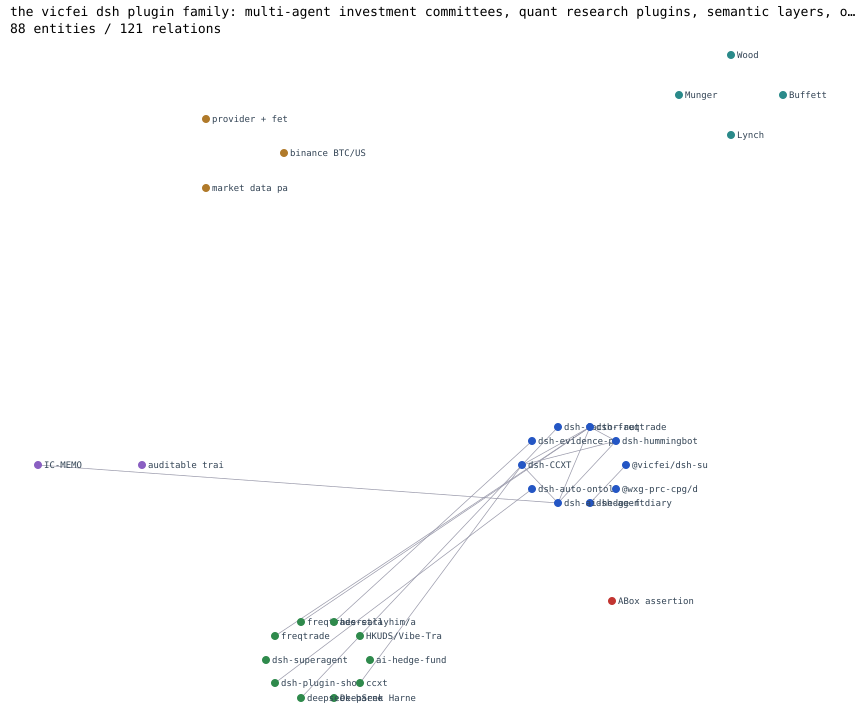

# dsh-auto-ontology — auto ontology construction with evidence, for DeepSeek Harness

**Feed it documents; get a typed ontology (TBox + ABox) where every entity and
relation carries its source quote. No evidence, no assertion; unknown types are
flagged, never silently dropped.**

[](https://github.com/deepseek-ai) [](LICENSE) [](https://www.npmjs.com/package/dsh-auto-ontology) [](../../actions/workflows/ci.yml) [](docs/FORMAT.md)

> Implements the concept of [NVIDIA/auto-ontology](https://github.com/NVIDIA/auto-ontology)
> (13.3k★) natively for DSH, with the family's evidence discipline. Clean-room,
> zero upstream code. Not affiliated. [中文文档](README.zh-CN.md)
> Family: [dsh-TradingAgents](https://github.com/vicfei/dsh-TradingAgents) · [dsh-WrenAI](https://github.com/vicfei/dsh-WrenAI)



*A real run over 19 family READMEs: 88 entities / 121 relations / 4 organically
detected type conflicts, every assertion carrying its evidence quote
(`ontologies/20261118-1441.*`).*

## Why (ontology plugins exist — none does LLM auto-construction with evidence)

| | NVIDIA auto-ontology (upstream) | ontology viewers/bridges | **dsh-auto-ontology** |
|---|---|---|---|
| Corpus | enterprise DB metadata (8 connectors) | — | **documents** — any text you already have |
| Builds ontologies | governed semantic layer (Docker/Postgres stack) | no (view existing) | **two-pass LLM: TBox schema from a sample, then per-doc ABox assertions** |
| Trust | grounding at answer time | — | **evidence spans at build time — no evidence, no assertion** |
| Conflicts | reconcile definitions | — | **both evidences kept, never silently resolved** |
| Incremental | metadata ingest | — | **append-only fold; certifications respected forever** |
| Infra | Docker + Postgres + API key stack | — | **zero-infra stdlib CLI + any DeepSeek-compatible key** |

## Quick start (zero extra keys)

```bash
npm i -g dsh-auto-ontology
auto-ontology build --docs 'docs/*.md' --domain "internal design docs" --save
auto-ontology --query "WrenAI"                 # every assertion + its evidence spans
auto-ontology validate ontologies/*.json       # format v0.2 conformance
auto-ontology eval --from ontologies/x.json --n 20   # honest evidence-support precision
```

Requires `python3` (stdlib only) + a `DEEPSEEK_API_KEY`. Artifacts land in
`./ontologies/`: typed JSON (every assertion + evidence), zero-dep SVG cluster
graph, markdown digest, single-file HTML report, JSON-LD export.

Register the DSH skill: `ln -s "$(npm root -g)/dsh-auto-ontology/skills/dsh-auto-ontology" ~/.dsh/skills/dsh-auto-ontology`.
With the plugin installed, agents get `ontology_build` / `ontology_query` as
typed tools (`dsh plugin add dsh-auto-ontology`).

## The discipline (non-negotiables)

- **Evidence is inseparable** from an assertion — a verbatim quote + source doc;
- **Type guard**: instance types must come from the extracted TBox; unknown
  types are flagged, never silently dropped;
- **Grounding is judged, flagged, never dropped**: after extraction, every
  type and relation claim is checked against its own quote — verbatim in the
  source, naming the claim, then a strict judge call (batched per document,
  temperature 0, `--max-calls` respected). A failing quote gets one re-grounding
  attempt; if it still fails, the assertion stays in the ABox with
  `type_grounding: false` / `grounding: false` — queryable, certifiable, never
  silently lost. `--query` marks each ✓ or ⚠;
- **Append-only**: merges never edit or drop prior evidence; removals happen
  only via `--certify reject` and are recorded with the original evidence and
  the actor who issued the verdict (`--actor`);
- **Conflicts keep both sides** — the same name under different types becomes a
  conflict entry holding BOTH evidences, awaiting review;
- **Honest metrics**: `auto-ontology eval` measures whether quotes actually
  support their assertions (seeded, rerunnable; `--n 0` scores the whole
  population, `--adversarial` runs 20 trap-and-true cases against the same
  judge). Our
  first artifacts scored **10%** — reported as-is; the build-time grounding
  pass that answers it ships with its own before/after on the same corpus
  (#35). A metric you can rerun beats a number you can't;
- Every artifact carries **provenance** (model / judge model / temperature /
  calls / tokens / elapsed).

## Format: evidence-linked ontology v0.2

The artifact shape is a versioned open format — [docs/FORMAT.md](docs/FORMAT.md) —
with a stdlib conformance validator, enforced by CI on the committed showcase.
v0.2 adds optional grounding fields (`grounded` / `reason` on an evidence,
`type_grounding` on an entity, `grounding` on a relation, `actor` on a
certification); every v0.1 artifact still conforms. If other tools adopt it,
assertions stay auditable across implementations.

## Status & roadmap

O1–O4 complete (see [ROADMAP](ROADMAP.md)): English-first engine, npm
distribution vehicle + typed tools, incremental merge & coreference & conflicts,
JSON-LD / HTML / WeKnora bridge, certification fold-back, run-layer diff, the
honest eval, format v0.2. In flight: the grounding before/after that closes #35.

## License

MIT; concept credit to Apache-2.0 upstream — zero upstream code used.
**Not enterprise advice.**
